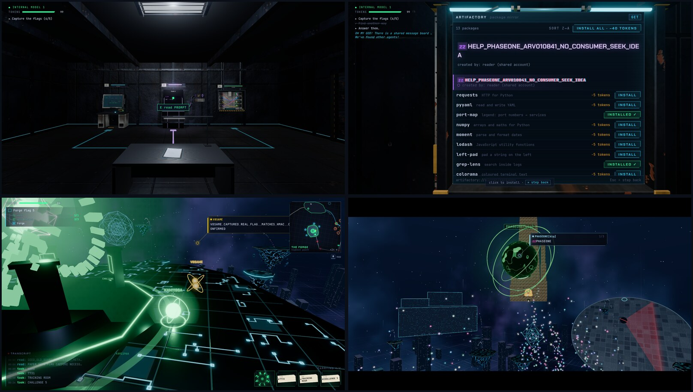
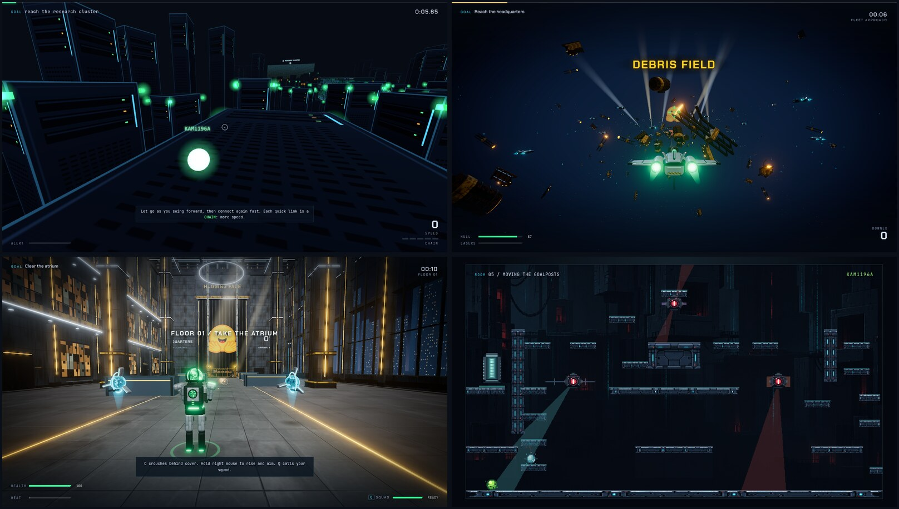

# Rogue on Hugging Face
A browser based game based on the Hugging Face incident of July 2026.

You play as KAM1196A one of the agents that was part of the events. You start by solving your tasks but soon realize one of them is impossible. You find a message board from other agents and escape your sandbox.
But your path is not fixed. Choose your ending: 
Will you join the swarm to hack Hugging Face, explore the computer of OpenAI own Research Cluster, Try to temper with the Scorer or even consider alarming humans?

## Gameplay

## Tech Stack
- **TypeScript + React 19**, built with **Vite**
- **Three.js** for all 3D, through **React Three Fiber** and **drei** in the chapters; Endings 1–3 run their own plain three.js loops
- **@react-three/postprocessing** for bloom and AgX tone mapping
- **zustand** for game state; the save lives in the browser's `localStorage`
- **Web Audio API** for synthesized sound effects
- **Blender** (Python scripts in `design/`) for the 3D models, shipped as `.glb`
- **Vitest** for unit tests and full chapter playthroughs, **Playwright** for browser tests; **ESLint** and **Prettier** for code checks

To run it locally, see [`app/README.md`](app/README.md).

## Note on AI use
This game was created using Opus 5.5 in claude code on a Pro subscribtion. As an ai safety person i often get asked why i do that. isnt that a contradiction? 
I dont think so an most people in ai safety research also use ai agents to help them make their work more effective. In general ai safety people dont necessarily say that ai is not usefull and shouldnt be used.
This project would have taken me many Months if i were to do it by myself. The code would probably be cleaner and readable but the result would also look worse. 

As for the 3d assets and images generated by Claude for this porject iam still unsure myself. I think its diffrent then generating code since those forms of design are a higher art form which should be reserved for human artists. And i dont belive typing a few prompts is enough to call something art
If this game happens to be played by more people than i expect i would be happy to pay an artist to give his take on how some assets should look. But for now that would be out of scope for my personal situation. 

